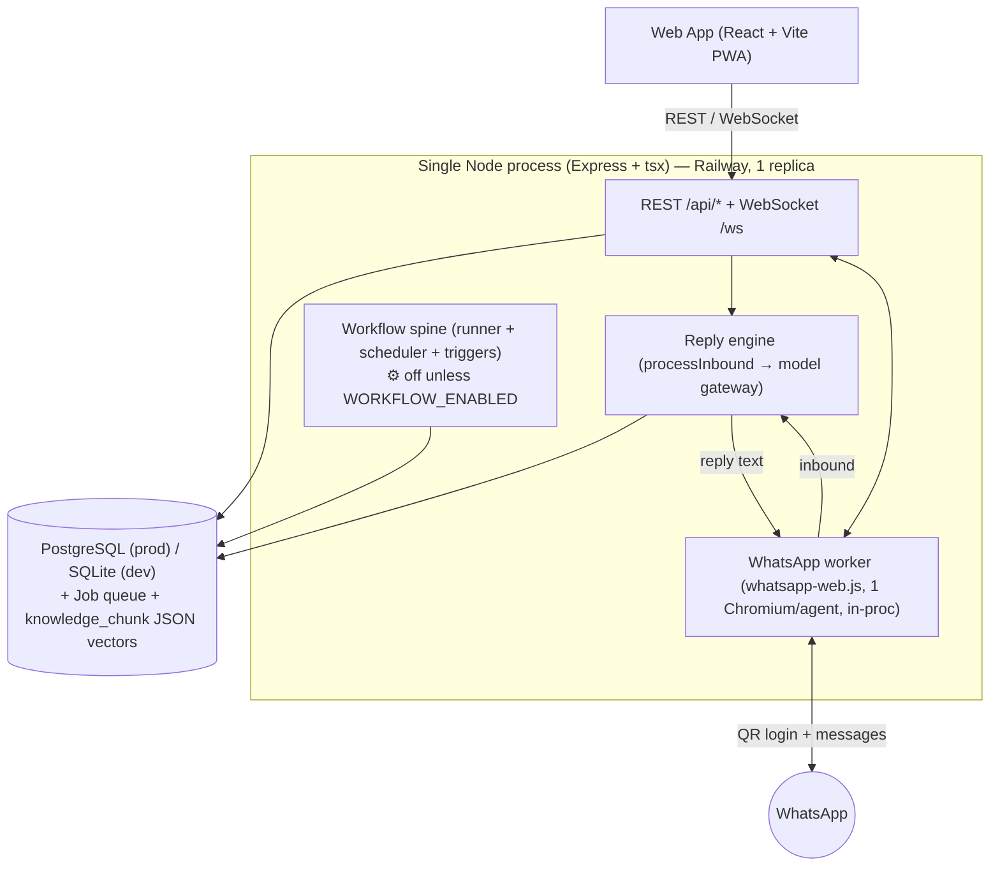
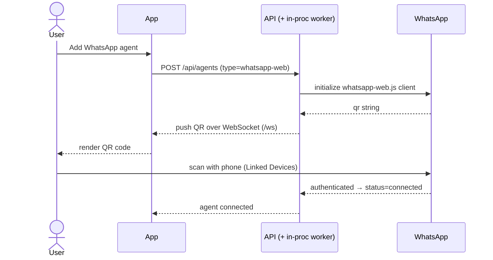
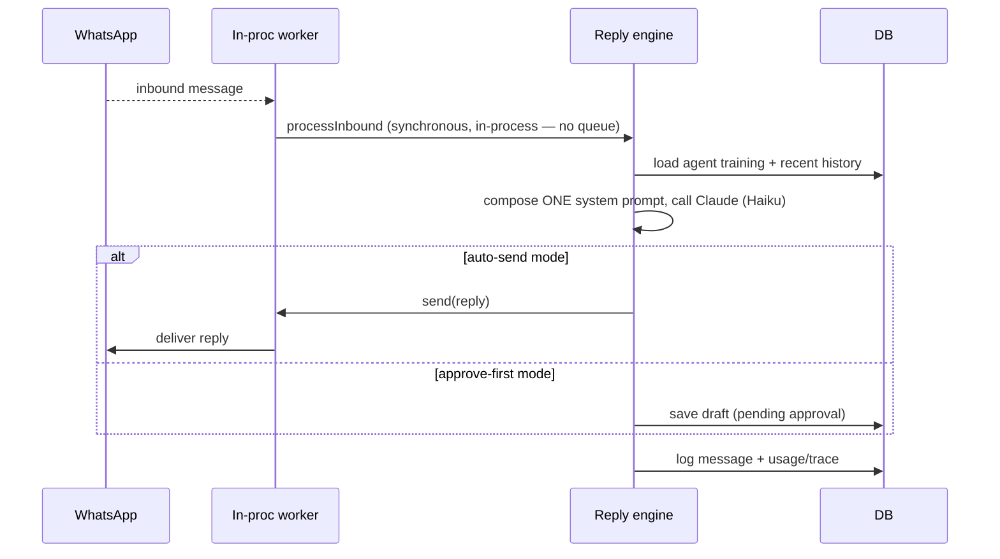

# Architecture

> **Source of truth: the code. Last reconciled 2026-11-14.** (PXD-15)
> This describes the **live `server/` + `client/` SaaS as shipped** (Phases 0–6). Where an earlier
> draft promised Redis, a separate worker process, Postgres RLS, RemoteAuth or pgvector, those are
> **not built** — the corrected reality is called out inline and summarised in [§Deferred / not built](#deferred--not-built).
> Deeper, subsystem-level reference lives in the companion docs linked at the bottom and under
> [`docs/architecture/`](architecture/README.md).

## Components

| Component | Tech | Responsibility |
|---|---|---|
| **App** | React 18 + Vite + TypeScript (PWA, Capacitor-ready) | Web UI: signup, add agent, show QR, train, inbox, analytics |
| **API server** | Node 20 + TypeScript (**Express** + Prisma, run via `tsx`) | REST `/api/*` + WebSocket `/ws`; auth, agents, training, reply engine, policy, workflow spine |
| **WhatsApp session worker** | `whatsapp-web.js` (**in-process**, one Chromium per agent) | Holds one live WhatsApp session per agent; emits QR; sends/receives. Runs **inside** the API process — not a separate service. |
| **Reply engine** | Anthropic SDK via the model gateway | Builds the prompt from an agent's training, calls Claude (Haiku by default), returns the reply or a draft |
| **PostgreSQL** | Managed (Railway) in prod · **SQLite** in dev/test | All tenant data. RAG vectors are stored as **JSON arrays in ordinary columns** — no pgvector extension (see [TRAINING.md](TRAINING.md)). |

The whole backend is **one Node process, one container, `numReplicas=1`**. The API, the WebSocket hub,
the in-process WhatsApp worker and the optional workflow spine all run in that single process.

> **No Redis, no message broker.** The durable job queue is **Postgres-backed** (a `Job` table claimed
> with a lease), and realtime push is an **in-memory** per-agent WebSocket fan-out. The `docker-compose.yml`
> historically declared a Redis service the code never used; it is being removed. See [DEPLOY.md](../DEPLOY.md).

## System diagram

## Flow 1 — Add a WhatsApp agent (QR login)

Each number becomes a separate agent with its own session. Sessions persist via `whatsapp-web.js`
**`LocalAuth`** on a filesystem path (`WWEBJS_DATA_PATH`), restored on boot — **not** RemoteAuth/DB/S3.
On an ephemeral host without a mounted volume, a deploy wipes sessions and forces a re-scan; the fix is
a persistent volume (see [DEPLOY.md](../DEPLOY.md) Option C).

## Flow 2 — Reply to an inbound message

Training is **loaded from the DB on every message**, so any training change takes effect on the very
next message — no restart, no redeploy. Inbound handling is **synchronous and in-process** inside each
channel's receive callback; there is no inbound queue.

### Reply mode vs. agentic mode

- **Reply mode (default):** exactly **one** `askClaude` call per inbound message — compose prompt →
  model → auto-send or draft. This is the byte-for-byte original path.
- **Agentic mode (additive, opt-in):** only when an agent's `executionMode === 'agentic'` **and** it has
  enabled tools. It runs a bounded tool loop (`knowledge.search`, `data.query`/`data.action`, etc.).
  With the flags/tools off, the reply path is byte-for-byte identical to reply mode. See [EXTENDING.md](EXTENDING.md).

## Channel adapters (self-registering registry)

Every channel implements one interface and **self-registers** into an in-process `Map` at module load;
the core engine never imports a concrete adapter — it looks one up by `type` via `getAdapter()`.

| Channel | `type` | Transport | Onboarding |
|---|---|---|---|
| WhatsApp | `whatsapp-web` | `whatsapp-web.js` (unofficial), 1 Chromium/agent | QR |
| Telegram | `telegram` | Bot API long-poll | Bot token |
| Website widget | `website` | Embeddable `widget.js` that **polls** for replies (so `send()` is a deliberate no-op) | Paste embed snippet |

The engine only sees a normalised `InboundMessage`/`Reply` shape, so training and the reply engine are
channel-agnostic. Adding a channel = one new module + one `register()` call. The same pattern backs the
**tool**, **workflow-handler** and **trigger** registries (see [EXTENDING.md](EXTENDING.md)).

> The LinkedIn agent is **owner-operated** and runs as a **separate, own-machine worker**
> (`npm run linkedin:worker`), not a channel adapter in the API process — see [LINKEDIN_AGENT_PLAN.md](LINKEDIN_AGENT_PLAN.md).

## Workflow spine (durable jobs — Postgres, not Redis)

When `WORKFLOW_ENABLED` is set, the process starts two in-process tickers:

- **Runner** (`jobs/runner.ts`) — claims due `Job` rows with a lease, dispatches to a registered
  workflow handler by name, and applies a `StepResult` (`complete | retry{backoff} | sleep | awaitApproval | fail`).
- **Scheduler + trigger dispatcher** — ticks cron rows and drains events into jobs.

The queue is **the `Job` Postgres table**, not BullMQ/Redis. Default **off** → neither ticker starts and
the process is byte-for-byte as before. `stopSpine()` releases held leases on shutdown so a redeploy
strands no jobs. See [OBSERVABILITY.md](OBSERVABILITY.md) for traces and [POLICY_AND_AUDIT.md](POLICY_AND_AUDIT.md)
for the `awaitApproval` (approve-before-act) path.

## Multi-tenancy & security

- Every tenant-scoped row is reachable only through **application-level `orgId` filters** plus the
  `requireAgent`/permission middleware and a **default-deny policy engine** ([POLICY_AND_AUDIT.md](POLICY_AND_AUDIT.md)).
  **Postgres row-level security (RLS) is _not_ implemented** — isolation is enforced in the app layer.
- Secrets at rest (channel tokens, connector credentials) are encrypted via `lib/crypto.ts`
  (`ENCRYPTION_KEY`); bearer tokens are stored hashed (`tokenHash`).
- The app talks only to the API; it never touches sessions or the DB directly.
- Per-agent **approve-before-send** and a `NEEDS_HUMAN` escalation path mean sensitive messages are never
  auto-answered. Owner **urgent-lead alerts** fire via a model-emitted `[[ALERT]]` token (deduped, 6-h cooldown).

## Guardrails (how every feature is added)

- **Additive** — new subsystems layer on seams; they never rewrite the reply path.
- **Reply path byte-for-byte** — with new flags/tools off, an inbound reply is identical to the original.
- **Self-registering registries** — channels, tools, workflow handlers, triggers, templates.
- **Approve-before-act** — privileged actions park on an `Approval` row until a human OKs.
- **Flags default off** — `WORKFLOW_ENABLED`, `OUTBOUND_ENABLED`, `MEMORY_ENABLED`, agentic tools, etc.

## Deferred / not built

These appeared in earlier design drafts but are **not in the shipped code**:

| Claimed | Reality |
|---|---|
| Redis / BullMQ job queue + pub/sub | **Not built.** Jobs = Postgres `Job` table (in-process runner); realtime = in-memory WebSocket fan-out. `docker-compose` Redis is unused and being dropped. |
| Separate worker **process** | **Not built.** The WhatsApp worker and workflow spine run **in the one API process**. (The LinkedIn worker is a separate *own-machine* script, not a server process.) |
| Postgres row-level security (RLS) | **Not built.** Tenant isolation is application-level + policy engine. |
| RemoteAuth (DB/S3 session store) | **Not built.** `LocalAuth` on a filesystem volume (`WWEBJS_DATA_PATH`). |
| pgvector | **Not built / deferred.** RAG uses in-process cosine over JSON-array embeddings with a keyword fallback — see [TRAINING.md](TRAINING.md). |
| Horizontal scaling (multi-replica) | **Not built.** In-memory maps assume a single replica (`numReplicas=1`). |

---

**See also:** [architecture/README.md](architecture/README.md) (index) · [EXTENDING.md](EXTENDING.md) ·
[TRAINING.md](TRAINING.md) · [DATA_MODEL.md](DATA_MODEL.md) · [OBSERVABILITY.md](OBSERVABILITY.md) ·
[POLICY_AND_AUDIT.md](POLICY_AND_AUDIT.md) · [CONNECTORS.md](CONNECTORS.md) · [DEV.md](DEV.md) · [DEPLOY.md](../DEPLOY.md)
