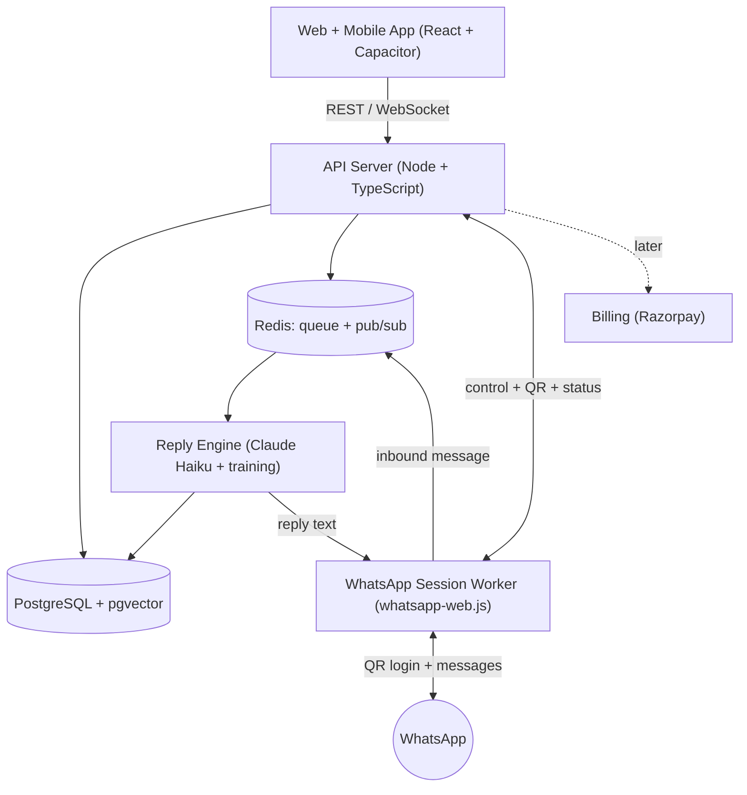
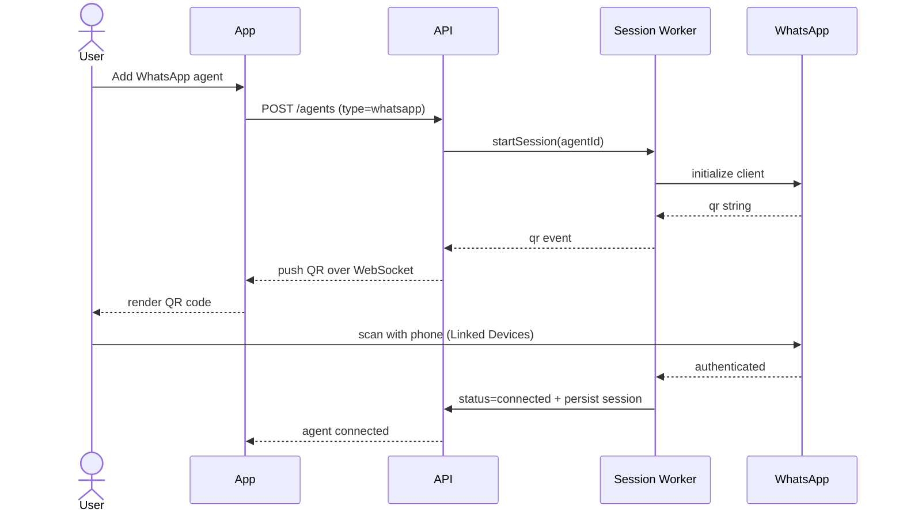
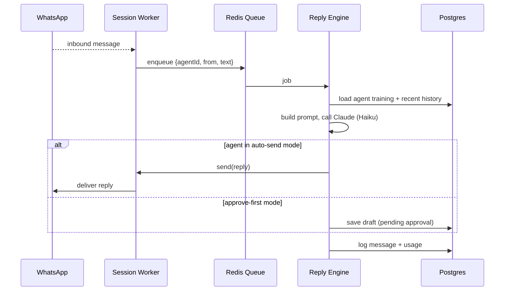

# Architecture

## Components

| Component | Tech | Responsibility |
|---|---|---|
| **App** | React + Vite + TypeScript + Capacitor | Web + iOS + Android UI: signup, add agent, show QR, train, view conversations |
| **API server** | Node + TypeScript (**Express** + Prisma, ClassPe-aligned) | REST `/api/*` + WebSocket; auth, agents, training, orchestration |
| **WhatsApp session worker** | Node + `whatsapp-web.js` | Holds one live WhatsApp session per agent; emits QR; sends/receives messages |
| **Reply engine** | Node + Anthropic SDK | Builds the prompt from an agent's training, calls Claude, returns the reply |
| **PostgreSQL (+ pgvector)** | Managed (Neon/Supabase) | All tenant data + vector embeddings for link knowledge |
| **Redis** | Managed (Upstash) | Job queue (BullMQ) + pub/sub for realtime QR/status/message push |

The **API** and the **session worker** are separate processes because WhatsApp sessions are
long-lived and resource-heavy — they must survive API deploys and scale independently.

## System diagram



## Flow 1 — Add a WhatsApp agent (QR login)



A user repeats this for every number — each becomes a separate agent with its own session.

## Flow 2 — Reply to an inbound message



Because the engine **loads training from the DB on every message**, any training change the
user saves takes effect on the very next message — no restart, no redeploy.

## WhatsApp session manager

This is the hardest part of Phase 1, so it gets its own design.

- **One `whatsapp-web.js` Client per agent.** Each client is a headless Chromium session
  (~200–400 MB RAM). The worker keeps a map of `agentId -> Client`.
- **Persistent auth with `RemoteAuth`.** Store each session's auth state in Postgres or S3
  (not just local disk) so sessions **survive worker restarts** and can move between worker
  instances. On worker boot, it restores all `connected` agents' sessions.
- **QR relay.** The client's `qr` event is forwarded to the API, which pushes it to the app
  over WebSocket; the app renders it. A new QR replaces the old one until the user scans.
- **Status model per session:** `pending_qr → connecting → connected → (disconnected | auth_failed)`.
  The app subscribes and shows the right UI for each.
- **Reconnection.** On `disconnected`, the worker retries with backoff; if auth is lost, it
  moves the agent back to `pending_qr` and asks the user to re-scan.
- **Resource ceiling.** N sessions = N browsers. This caps how many agents one worker holds
  (plan for ~25–50 per worker box; scale horizontally by sharding agents across workers).
  **This is the main reason heavy/paid scale later moves to the Cloud API** (webhooks, no browser).

### Migration path to the official Cloud API

Both methods sit behind one **channel adapter** interface (below), so switching an agent from
`whatsapp-web` (QR) to `whatsapp-cloud` (Meta Embedded Signup) is a config change, not a rewrite.

## Channel adapter design

Every channel implements one interface, so adding a channel never touches the core engine:

```ts
interface ChannelAdapter {
  type: 'whatsapp-web' | 'whatsapp-cloud' | 'instagram' | 'gmail' | ...;
  onboard(agent): OnboardingHandle;        // QR (whatsapp-web) | OAuth | Embedded Signup
  start(agent): Promise<void>;             // begin receiving
  stop(agent): Promise<void>;
  onInbound(cb: (msg: Message) => void);   // normalise to a common Message shape
  send(agent, reply: Reply): Promise<void>;
}
```

- The engine only ever sees the common `Message` shape, so it is **channel-agnostic**.
- Adapters self-register in a registry; adding Instagram = a new adapter module + a row in the registry.

## Multi-tenancy & security

- Every row carries `org_id`; Postgres **row-level security** enforces isolation.
- WhatsApp session credentials and any OAuth tokens are **encrypted at rest** (envelope
  encryption or a secrets manager) — never plaintext.
- The app talks only to the API; it never touches sessions or the DB directly.
- Per-agent **approve-before-send** toggle and a `NEEDS_HUMAN` escalation path carry over from
  the prototype, so sensitive messages are never auto-answered.
