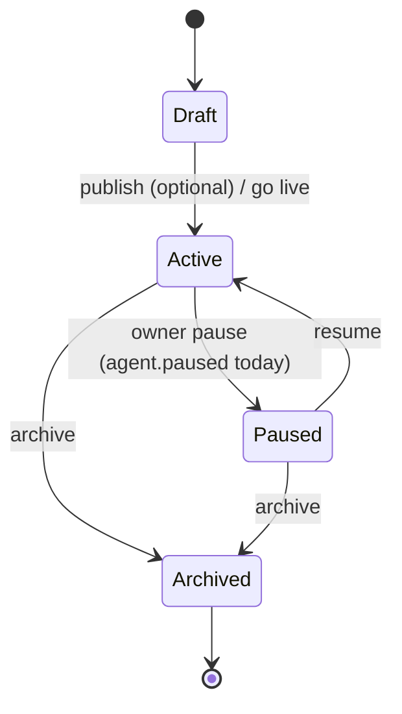
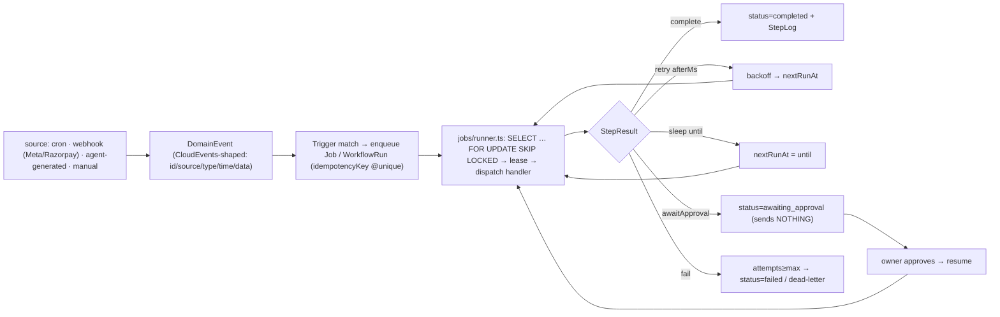

# Target Architecture — a generalized agentic platform, modular-monolith-first

> **Status:** Review draft (not finalized) · **Date:** 2026-11-14 · **Reads with:**
> [current-state.md](current-state.md), [gap-analysis.md](gap-analysis.md),
> [implementation-roadmap.md](implementation-roadmap.md). **No code has been changed.**
>
> **Decisions locked (2026-11-14), which override any option this document still presents:**
> (1) **`whatsapp-web.js` (QR) is the only agent transport** — the official **Cloud API / BROADCAST path is
> dropped**; outbound is the **Trackly-style QR drip** only (so the `whatsapp-cloud` adapter, the Meta inbound
> webhook, the `/api/v1` partner API and the `Campaign*`/`DeliveryEvent`/`WebhookEndpoint`/`ApiKey` tables
> below are **out of scope** — the Razorpay webhook stays). (2) **Standard scenarios only** — **flight
> monitoring (#4) and LinkedIn (#3) are dropped** from §12. (3) `agents/` + `platform/` are consolidated into
> `legacy/`. The authoritative, decision-aligned execution plan is **[backlog.md](backlog.md)**; where this
> document's text predates these decisions, the backlog supersedes it.

This document answers master-prompt deliverables **#6 (target architecture)**, **#7 (diagram)**,
**#8 (lifecycle)**, **#9 (agent execution flow)**, **#10 (workflow execution flow)**,
**#11 (A2A design)**, **#12 (MCP strategy)**, **#13 (A2A strategy)**, **#14 (database design)**,
**#15 (API design)**, **#16 (security & permission architecture)**, **#17 (tech decisions)** and
**#18 (end-to-end scenario validation)**.

**Design stance.** One deployable (`server/`), a **modular monolith** on **PostgreSQL as the single
backbone** (relational store + job queue via `SKIP LOCKED` + event outbox + later pgvector). Every piece
below is **additive** around the three proven seams — the **channel-adapter registry**, the single
**`askClaude` chokepoint**, and the **pure prompt/training functions** — and the **single-turn reply loop
stays the default, byte-for-byte**. Heavy standards enter only on a recorded trigger (see
[gap-analysis.md §4](gap-analysis.md)).

---

## 1. Logical architecture

The master prompt's separation of concerns (Agent = intelligence, Workflow = execution control, Tool =
capability, Trigger = event, Memory = context, Policy = authorization, Observability = traces) maps onto
these modules. **Bold = new; *italic* = evolve-in-place; plain = reuse as-is.**

```
                         ┌───────────────────────────────────────────────────────────┐
  TRIGGERS               │  client/ (React PWA)   —   partner /api/v1 (API key, later) │
  ┌──────────────┐  REST/WS                     │                                      │
  │ channel event │────────────────────────────►│  Express API  ·  /ws realtime        │
  │ (adapter)     │      webhook (Meta/Razorpay) │  **authz middleware (default-deny)** │
  │ **cron tick** │────► **webhooks router** ───►│  **AuditLog**                        │
  │ **webhook**   │                              └───────┬──────────────────────────────┘
  └──────────────┘                                       │
                                                         ▼
     ┌───────────────────────────── AGENT RUNTIME ──────────────────────────────┐
     │  *engine.processInbound* (executionMode:'reply', DEFAULT — unchanged)      │
     │     load spec/training → compose prompt → **model-gateway** → send/draft   │
     │  **runtime facade** → executionMode:'agentic' → bounded tool loop (opt-in) │
     └───────┬───────────────┬───────────────┬───────────────┬───────────────────┘
             ▼               ▼               ▼               ▼
      **Tool registry**  Channel registry  **Policy engine** **Model gateway**
      whatsapp.send_msg   whatsapp-web      authorize()       provider-abstracted
      crm.create_lead     telegram          **Approval queue**  token/cost capture
      knowledge.search    website           consent/budget      retry/timeout
      calendar.book       **wa-cloud**                          (Anthropic now)
             │                                                        │
             ▼                                                        ▼
   ┌─────────────────────────── MEMORY / KNOWLEDGE ───────────────┐  **execution trace**
   │ Conversation/Message (convo)  ·  TrainingProfile/Source (KB) │   (extended UsageEvent)
   │ **ContactMemory** (per-contact)  ·  **KnowledgeChunk+pgvector│   + **pino** structured logs
   │  (RAG, on-trigger)**                                          │
   └──────────────────────────────────────────────────────────────┘
                                   │
     ┌───────────────── EVENT / WORKFLOW SPINE (Postgres-backed) ──────────────┐
     │ **DomainEvent envelope (CloudEvents-shaped)** · **Trigger** · **Job**    │
     │ **WorkflowRun / StepLog** · **jobs/runner (SKIP LOCKED)** · scheduler    │
     │ handlers: scheduled-monitor · outbound-drip · approval-gated-send        │
     └─────────────────────────────────────────────────────────────────────────┘
                                   │
        PostgreSQL (one backbone: relational + queue + outbox + pgvector-later)
        ConnectedAccount (AES-GCM secrets) · AgentVersion · prisma migrations
```

### Module responsibilities

| Layer | Module(s) | New / evolve / reuse |
|---|---|---|
| **Model gateway** | `lib/model-gateway.ts` | *evolve* `brain.ts` in place; `askClaude` becomes a thin wrapper |
| **Runtime** | `engine/runtime.ts`, `engine/loader.ts`, *`engine/engine.ts`* | reply path reused verbatim; agentic path is a new opt-in sibling |
| **Agent Spec** | `lib/agentSpec.ts`, `lib/agentBuilder.ts`; `AgentVersion` table | new; a serialization of existing rows + snapshot/rollback |
| **Tools** | `tools/registry.ts`, `tools/execute.ts`, `tools/builtin/*` | new; mirrors the channel registry |
| **Channels** | `channels/registry.ts`, `channels/*` | reuse; add `whatsapp-cloud`, OAuth connectors later |
| **Event/Workflow** | `events/`, `workflow/`, `jobs/`, `triggers/`, `webhooks` | new; Postgres state machine + node-cron |
| **Memory/Knowledge** | `TrainingSource`, `ContactMemory`, `KnowledgeChunk`(pgvector) | reuse + additive |
| **Policy/HITL** | `policy/engine.ts`, `policy/approvals.ts`, `middleware/authz.ts`, `lib/audit.ts`, `lib/budget.ts` | new; generalizes approve-before-send |
| **Identity** | *`middleware/auth.ts`*, `ConnectedAccount`, `lib/secrets.ts` | evolve + new credential store |
| **Observability** | `lib/trace.ts`, `lib/pricing.ts`, extended `UsageEvent`, pino | new; DB-backed execution trace |

---

## 2. Agent Specification (deliverable adjacent to #6; master-prompt §4B)

The spec is a **versioned zod document that is the canonical serialization of what already exists** — it
introduces *no new executable concepts*, it is a superset of `Agent` + `TrainingProfile` + `TrainingSource`.

```ts
// lib/agentSpec.ts — illustrative shape (zod schema in code; emit JSON Schema later if an external
// validator needs it). Forward-declared empty arrays keep the shape future-proof with no dead DB columns.
AgentSpec = {
  specVersion: 1,
  identity:  { name },
  channel:   { type, channelConfig },              // -> Agent.channelType / channelConfig
  persona:   { instructions, restrictions, tone, language, escalationKeyword }, // -> TrainingProfile
  knowledge: [ {type:'fact'|'faq'|'link', data} ], // -> TrainingSource rows
  behavior:  { approval:'auto'|'draft', hours, timezone, awayMessage,
               alerts:{ number, condition } },      // -> Agent.autoSend / hours / alertNumber / alertCondition
  tools:        [],   // forward-declared; populated once the tool registry exists (Phase 6)
  capabilities: [],   // forward-declared
  workflowRefs: [],   // forward-declared
  evaluationCriteria: [],
}
```

Two pure functions bridge spec ↔ rows, so the hot path never changes shape:
`specFromAgent(agentId)` (serialize) and `applySpec(agentId, spec)` (compile → rows →
[`composeSystemPrompt`](../../server/src/lib/training.ts) stays the final compile target). **Both the NL
builder and the form/template path route through `applySpec()`** — which is exactly what makes "NL and
visual produce the same definition" true *by construction*.

---

## 3. Agent lifecycle (deliverable #8; master-prompt §6)

The master prompt's 10-state machine is collapsed to **four SMB-right states** carried on a **new
`Agent.lifecycleStatus` column** — never on the existing `Agent.status`, which already means *connection*
state and would collide.



- **Validation/Testing** = the existing **Test Console** (`POST /test` → `draftFor`).
- **Approval** = the existing **`autoSend` vs draft** toggle. **Deployment/Updating** = **publishing a new
  `AgentVersion`** (atomic `currentVersionId` swap). **Disabled** folds into **Paused**.
- **Rollback** (set `currentVersionId` back to an earlier row) is the single highest-value payoff — the
  owner edits a live bot against prod today with **no undo**.
- **Live-edit stays the default.** `currentVersionId = null` → the agent reads live `TrainingProfile` /
  `TrainingSource` exactly as today ("edit applies to the next message, no retrain"). Publishing is
  **explicit and optional** so the instant-edit promise survives.

---

## 4. Agent execution flow (deliverable #9)

A **hybrid runtime**: deterministic by default, agentic only when an agent opts in. `executionId` +
`agentVersion` are threaded through so every run is traceable.

```mermaid
flowchart TD
  IN["Trigger: channel event / cron / webhook"] --> F{"runtime facade:<br/>executionMode?"}
  F -->|reply (DEFAULT)| R1["processInbound — UNCHANGED:<br/>load spec/training → compose prompt"]
  R1 --> GW["model-gateway.callModel()<br/>timeout · retry · token+cost capture"]
  GW --> POST["post-process (deterministic):<br/>extractAlert [[ALERT]] · applyLinks {{LINK}} · NEEDS_HUMAN"]
  POST --> D{"autoSend?"}
  D -->|yes| SEND["adapter.send() → status 'sent'"]
  D -->|no| DRAFT["save draft → Approval queue"]
  F -->|agentic (opt-in)| A1["bounded tool loop (hard step cap + timeout)"]
  A1 --> GW
  GW -->|stop_reason=tool_use| TOOL["authorize(ctx,action) → executeTool() → tool_result"]
  TOOL --> A1
  A1 --> POST
  SEND --> TR["execution trace: executionId · agentVersion · model · tokens · cost · latency · outcome"]
  DRAFT --> TR
  POST --> BUD{"budget gate<br/>(pre-call, per-tenant)"}
```

Guarantees preserved on the reply path: ack-filter, pause/takeover/mute, business-hours away-once,
`NEEDS_HUMAN`, `[[ALERT]]` (6-h dedupe), `{{LINK:Name}}` exact-URL substitution, auto-send-vs-draft — all
**byte-identical**. A **per-conversation async lock** wraps `processInbound` (restoring the prototype's
lost queue) so two rapid messages never double-reply. A **per-tenant budget gate** runs *before* the model
call (closing the widget-spend hole). The **tool loop never runs** unless `executionMode='agentic'`.

**Rule (non-negotiable):** *no model-emitted token ever authorizes a privileged action.* `[[ALERT]]` /
`NEEDS_HUMAN` stay safe (they only reduce capability or notify); when real tools arrive, every tool call
re-authorizes server-side through the policy engine.

---

## 5. Workflow & event execution flow (deliverable #10; master-prompt §4D, §4H)

A **Postgres-backed durable state machine**, not a distributed engine. One in-process ticker (node-cron
~30–60 s) behind a `WORKFLOW_ENABLED` flag (default off → byte-for-byte today). The **hot reply loop stays
inline** — only proactive/outbound/scheduled work goes through the spine.



Handlers (code, not a DSL): **scheduled-monitor** (flight/price/offer: fetch → diff → notify via
`adapter.send`, a generalization of today's `alertOwner`), **outbound-drip** (the Trackly cap/window/jitter
+ send-ledger + opt-out), **approval-gated-send**. Pause/resume/cancel = status transitions; history/replay
= `StepLog` rows. A `lease/leaseUntil` column is added **now** (even at `numReplicas=1`) so a future second
worker can claim runs safely. Graduates to **pg-boss** (same Postgres, no Redis) only on measured volume.

**Webhook ingestion** uses a raw-body route (`/api/webhooks/*`, bypassing `express.json`) with
`hub.verify_token` + HMAC signature + dedupe on provider message id — this is also what finally makes
**billing server-authoritative** (wires the already-written `verifyWebhookSignature`).

---

## 6. Tool & Integration Registry (master-prompt §4E) + MCP strategy (§4F)

**Tools** are an in-process typed registry that **mirrors the channel-adapter registry** — a `Map` with
`registerTool`/`getTool`/`listTools`, self-registering at module load:

```ts
// tools/types.ts
Tool<I,O> = { name, description, inputSchema /*zod → Anthropic JSON Schema*/, outputSchema,
              sideEffect:'read'|'write'|'external', permission, idempotent?, timeoutMs?,
              execute(input, ctx: {agent, orgId, conversationId}) }
```

`tools/execute.ts` is the **common execution interface**: enforces side-effect class (write/external route
through the **policy engine + approve-before-send**), per-tool timeout + one retry, idempotency, the error
contract, and one structured log line. First tools wrap capabilities that **already exist**:
`whatsapp.send_message` → `getAdapter(agent.channelType).send`; `crm.create_lead/update_lead` → the
`Conversation`/`leadStatus`/`leadNotes` writes (no new tables); `knowledge.search` → `TrainingSource`
(keyword/LIKE first, pgvector-ready behind the same signature); `calendar.book` for appointments (highest
tier-2 value); `browser.fetch_page` → `learn.ts` **after the SSRF allowlist lands**. Channel adapters stay
the transport layer — the two registries are **not** merged.

**MCP strategy:** adopt **client-only, allowlisted, later**. The in-process registry is the lighter
alternative to a full MCP mesh for the ~3–6 first-party tools the product needs. Keep the `Tool` contract
**MCP-shaped** (name + JSON-Schema input + structured result) so a single `McpToolAdapter` can later
*consume* external/community MCP servers behind the same registry — gated on the SSRF allowlist + the
secrets store + per-tenant cost caps. **Do not expose the platform as an MCP server** now. Every MCP call
flows through the same egress allowlist and treats tool results as **untrusted** (size-capped, never blindly
concatenated into the system prompt).

---

## 7. Multi-agent & A2A design (deliverables #11, #13; master-prompt §4G)

The data model **already** allows many `Agent`s per `Org` sharing training. "Coordination" starts as
**in-process hand-off to a shared lead/task record**, not a message bus:

```mermaid
flowchart LR
  PA["Personal Assistant agent"] -->|delegate() in-process| RA["Research sub-agent<br/>(narrower permissions)"]
  RA -->|writes| TASK["shared Task/Lead record (Postgres)"]
  SA["Sales agent"] -->|reads/writes| TASK
  TASK --> PA
```

An internal synchronous `delegate(role, task)` + a small role registry is introduced **only** when a real
context/permission-boundary use case appears (e.g. a web-fetching Research agent that must run with a
narrower allowlist). This is **P3**.

**A2A strategy:** **skip the external Google A2A protocol** (agent cards, per-agent HTTP servers, inter-agent
auth). All agents are first-party, in one process, under one `orgId` trust boundary — A2A solves
cross-vendor/cross-network interop the product does not have. Reopen only if third-party external-agent
interop becomes a product requirement; the internal `delegate()` seam is designed so that bridge is additive.

---

## 8. Memory & Knowledge architecture (master-prompt §4I)

Five scopes, each in the right store; **prompt-stuffing stays the default for small KBs** (it is cheaper
*and* more accurate for the tier-2 majority):

| Scope | Store | Today | Target |
|---|---|---|---|
| **Conversation** | `Conversation`/`Message` | last-8 truncation | + **rolling summary** replacing raw `take:8` when long |
| **Agent knowledge** | `TrainingSource` | stuffed wholesale into every prompt | + **token-budget guard**; **`KnowledgeChunk` + pgvector** *in existing Postgres* only when a KB outgrows the prompt |
| **Per-contact (personal)** | — | none | **`ContactMemory`** (per-contact facts + rolling summary + TTL, owner-visible/deletable) |
| **Operational** | `UsageEvent`→execution trace | bare counter | execution-trace rows (Phase 2) |
| **Shared org knowledge** | `TrainingProfile`/`TrainingSource` | per-agent | explicit sharing permissions; **never auto-share** one agent's memory to another |

RAG is **retrieval-on-trigger**: `knowledge.search` is the seam (keyword now, pgvector later), so the
prompt stops growing unbounded. The flip trigger: a tenant's training exceeds the prompt/token budget, or a
PDF/catalog upload is requested. No separate vector DB — pgvector is a Postgres extension.

---

## 9. Database design recommendations (deliverable #14)

All additive; **gated on migration discipline landing first** (Phase 1). Existing 11 models are preserved.

**Phase 1 (hardening):** backfill `orgId` (+ index) onto `ChannelSession`, `TrainingProfile`,
`TrainingSource`, `Message`; add `Message(conversationId, createdAt)` and `UsageEvent(orgId, createdAt)`
indexes; introduce `server/prisma/migrations/` (baseline vs a shadow of prod).

**Phase 2 (runtime/observability):** extend `UsageEvent` additively (nullable) → `executionId`,
`agentVersion`, `model`, `provider`, `inputTokens`, `outputTokens`, `costMicros`, `latencyMs`, `outcome`,
`trigger`, `conversationId`, `errorCode`, `approvalState`; add `Agent.executionMode @default("reply")`.

**Phase 3 (policy/identity):** `Approval`, `AuditLog` (append-only), `ConnectedAccount`/`Credential`
(`orgId`, `agentId?`, `provider`, `encBlob`, `keyId`, `scopes`, `status`, `expiresAt`); `User.token` →
`tokenHash` + `tokenExpiresAt` (+ optional `Session`); migrate Telegram `botToken` out of `channelConfig`.

**Phase 4 (spec):** `AgentVersion` (`agentId`, `version`, `specJson`, `status`, `note`, `createdAt`,
`@@unique([agentId, version])`) + nullable `Agent.currentVersionId` + `Agent.lifecycleStatus`.

**Phase 5 (event/workflow):** `DomainEvent`/outbox, `Trigger`, `Job` (`status`, `nextRunAt`, `attempts`,
`maxAttempts`, `stateJson`, `lease`, `leaseUntil`, `idempotencyKey @unique`), `WorkflowRun`, `WorkflowStepLog`;
outbound set from the plans (`Campaign`, `CampaignRecipient`, `OptOut`, `DeliveryEvent`, `WebhookEndpoint`,
`ApiKey` / or `OutboundConnection`, `OutboundSendLog`, `OutboundOptOut`); `Watch/Schedule`.

**Phase 6 (tools/RAG):** optional `KnowledgeChunk(agentId, orgId, sourceId, content, embedding vector)`;
`ContactMemory`; optional `Integration` for OAuth tool credentials.

**Deferred:** Postgres **RLS** policies per tenant table (defense-in-depth, after migrations + a
per-request tenant GUC).

---

## 10. API design recommendations (deliverable #15)

Additive, versioned where it leaves the first party. Existing `/api/*` surface is preserved.

| Area | Endpoints (new unless noted) |
|---|---|
| **Runtime/observability** | `GET /api/analytics/executions` (owner, filterable), `GET /api/analytics/executions/:id`, `GET /api/analytics/metrics`, `GET /api/health/ready` (DB + session readiness; replaces static `{ok:true}`) |
| **Policy/HITL** | `GET /api/approvals`, `POST /api/approvals/:id/approve\|reject` (idempotent; generalizes `/messages/:mid/approve\|skip`), `GET /api/audit` (owner), `POST /api/auth/logout` |
| **Identity** | `GET/DELETE /api/connected-accounts`, OAuth `…/connect/oauth/start` + `/api/oauth/callback/:provider` (per connector, deferred), `/ws` handshake now **requires a token** + org-owns-agent check, `POST /api/public/widget/:agentId/key` + per-agent cap |
| **Agent Spec / Studio** | `POST /api/agents/build {description,url?}` → `{spec,warnings}` (nothing saved), `POST /api/agents/:id/apply-spec`, `GET /api/agents/:id/spec`, `POST /api/agents/:id/versions` (publish), `POST /api/agents/:id/rollback`, `GET /api/channels` (from `registry.listAdapters()` — kills the hardcoded client channel drift) |
| **Workflow/triggers** | `POST/GET /api/agents/:id/workflows`, `GET /api/workflows/:runId`, `POST /api/workflows/:runId/pause\|resume\|cancel\|approve`, `POST/GET/DELETE /api/agents/:id/watches`, WS `'workflow'` event |
| **Webhooks / outbound** | `POST /api/webhooks/whatsapp` (Meta inbound + delivery, raw body + signature), `POST /api/webhooks/razorpay` (server-authoritative billing), partner `/api/v1/*` behind an org-scoped API key (per the BROADCAST plan) |

Cross-cutting API conventions to adopt as they land: **idempotency keys** on mutating/outbound routes,
consistent error envelopes (already `{error, code}`), pagination cursors, and `/api/v1` versioning at the
partner boundary.

---

## 11. Security & permission architecture (deliverable #16; master-prompt §4K + L)

**Authentication vs authorization are separated.** AuthN stays phone-OTP + bearer token, **hardened**:
hash at rest, expiry, rotate-on-login, `POST /logout`. AuthZ becomes **one default-deny chokepoint**.

```
every mutating route / every tool call
        │
        ▼
authorize(ctx, action) ──► {allow | require_approval | deny}      ◄── per-action permission table
        │                         │                                   (owner/member × action type)
        ▼                         ▼
     execute                 Approval queue (idempotent execute, expiresAt)
        │                         │
        ▼                         ▼
     audit()  ──────────────► AuditLog (append-only, org-scoped, owner-visible)
```

- **Permission levels** (read-only / auto / with-approval / prohibited) over action types: `send_reply`,
  `bulk_send`, `delete`, `financial`, `booking`, `social_publish`, `training_edit`, `org_admin`. The
  existing **approve-before-send draft is the first instance** of a `with-approval` action — bulk/booking/
  delete become additional `Approval` rows reusing the same inbox + approve/reject handlers.
- **Secrets:** app-level **AES-256-GCM** (`lib/crypto.ts`, env/secret-manager key + `keyId` for rotation);
  Telegram `botToken` and future OAuth tokens live in `ConnectedAccount`, decrypted only at send time,
  never in prompts or logs.
- **Per-tenant budgets** (`lib/budget.ts`): daily message/cost cap checked in `processInbound` **and** the
  public widget **before** the model call.
- **Prompt-injection posture:** no model output authorizes a privileged action (re-authorize every tool
  call server-side); validate tool inputs/outputs against a zod schema at the boundary; keep trusted
  (owner training) and untrusted (customer message, fetched page) content clearly separated.
- **The live holes, fixed in Phase 0:** per-socket `/ws` auth (token on connect + org-owns-agent), widget
  signed key + per-agent rate cap, **SSRF allowlist** in `learn.ts` (reject loopback/private/link-local/
  `169.254.169.254` incl. on redirects), non-reflecting CORS in prod, wired Razorpay webhook + block
  `/subscribe` free-upgrade in prod.
- **Deferred defense-in-depth:** Postgres **RLS** per tenant table (after migrations + a per-request tenant
  GUC) — the belt-and-braces for a forgotten `agentId` check.

---

## 12. End-to-end scenario validation (deliverable #18; master-prompt §8)

**The architecture-level pass/fail test:** *adding a new scenario touches an Agent Spec + at most one Tool
module + one Trigger registration, with zero changes to the core reply engine or the channel registry.*
All seven run on the one `trigger → runtime → tools → memory → policy → send → observability` spine.

| # | Scenario | Classification | Reuses | New pieces | Provider / ToS gate |
|---|---|---|---|---|---|
| 1 | **WhatsApp business agent** | **Shipping today** | `processInbound`, whatsapp-web, training | hardening only (WS auth, AI-path tests) | Reply-only within 24 h → low ban risk |
| 7 | **Appointment booking** | **Strongest near-term** | booking persona (`templates.ts`), draft-approve | `calendar.book` tool + bounded loop + approve-before-book | Google Calendar **OAuth2** |
| 2 | **Lead-gen / outbound** | **Near-term, compliance-gated** | `whatsappCloud.ts`, `processInbound` for replies | outbound-drip handler, send-ledger, consent/opt-out, spend cap, `whatsapp-cloud` adapter | **BROADCAST** (Cloud API + approved templates + opt-in) is the default; **TRACKLY** QR drip is *owner-accepted-risk*, secondary number, real permanent-ban risk |
| 6 | **Website offer monitoring** | **Near-term** | `learn.ts` fetch/extract, `alertOwner` notify | scheduled-monitor handler + `Watch` row (fetch → diff → notify) | needs the **SSRF allowlist** first |
| 5 | **Multi-agent business system** | **Structural now; delegation later** | many-agents-per-org, shared inbox | in-process `delegate()` to a shared task record (P3) | in-process — **no A2A/broker** |
| 4 | **Flight monitoring** | **Aspirational / demo** | the generic cron→tool→notify spine | `flight.*` HTTP tool | off-mission for tier-2; 3rd-party API cost/ToS |
| 3 | **LinkedIn marketing** | **Aspirational / constrained** | adapter + scheduled-publish trigger | compliant content-publish only | **No DM-automation API; DM auto-reply must not be built** — content-only via partner-approved API + OAuth2 |

This validates the master-prompt requirement that the *same* infrastructure serves every use case:
conversational scenarios (1, parts of 5, 7) reuse `processInbound`; watcher scenarios (4, 6) are the same
program with a cron trigger and a generalized `alertOwner` notify; outbound (2) is the biggest addition and
is **already fully designed** in [BROADCAST_INTEGRATION_PLAN.md](../../docs/BROADCAST_INTEGRATION_PLAN.md)
and [TRACKLY_INTEGRATION_PLAN.md](../../docs/TRACKLY_INTEGRATION_PLAN.md).

---

## 13. Non-functional targets & the bottlenecks to *validate* (master-prompt §9)

Do not claim scalability — **measure it**:

- **Memory-per-WhatsApp-session is the scarce resource**, not event throughput. Measure real RSS/agent on
  the target Railway instance to get a true agents-per-box ceiling; split the session worker (behind the
  adapter seam) only when a measured % of that ceiling is hit — **and move the per-conversation lock to
  Postgres advisory locks in the same change** (the in-memory lock is single-process-only).
- **Horizontal scale is a coordinated change, not a flag:** the WS hub, session map, and rate limiter are
  all in-memory/process-local. Demonstrate that a second replica breaks WS routing + session ownership to
  document the pre-split constraints; introduce Redis only then.
- **Backpressure / durability:** the Postgres inbound-dispatch queue (concurrency cap + retry/backoff +
  dead-letter) replaces today's "a failed Claude call drops the message."
- **DR:** confirm Railway Postgres backups with a **real restore drill**; verify WhatsApp session
  persistence survives a redeploy (`WWEBJS_DATA_PATH` volume, or RemoteAuth when it lands).
- **Cost control:** per-tenant token/cost counters (from the execution trace) back the budget gate.

---

## 14. Why this is the right target

It satisfies the master prompt's dual mandate — **deterministic execution where steps are known, agentic
reasoning where they aren't** — on **one shared runtime, registry, authz, and observability substrate**,
while honoring its explicit cautions (modular monolith, don't adopt every standard, preserve working
features, don't claim unvalidated scale). A new use case is **configuration + at most one tool + one
trigger**, not new infrastructure. The sequencing that gets here safely is in
[implementation-roadmap.md](implementation-roadmap.md).
